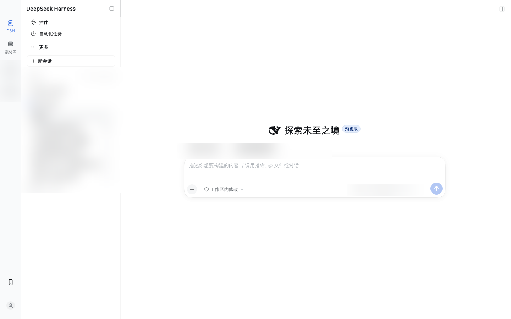

# Three-Column App Layout for DSH | DSH 三栏应用布局

[中文](#三栏应用布局) | English

A generic DeepSeek Harness (DSH) layout plugin that replaces the stock sidebar with an application rail, an app-specific secondary column, and the content area. Package id: `@fenixgo/dsh-three-column-layout`, loader row: `layout-shell`.



> Workspaces, session titles, and business content in the screenshot are blurred.

## Behavior

- Column 1 (the application rail) stays 60px whether the second column is expanded or collapsed; icon buttons use 6px vertical gaps and 6px icon-label spacing.
- Hover/selected state uses a blue accent that only changes the `color` of icon and text (icons follow via `currentColor`); no background fill. Shared by the rail, second-column rows, the New Session button, and header icon buttons through the `layout-shell-hover-accent` class.
- The outer sidebar track is set to 340px on load and on every expansion, giving the second column a default 280px. Native dragging still works; re-expanding restores the default.
- When the second column is folded, the 60px rail remains and the missing width is compensated in the frame, so the main content is never covered. The rail's entries, icons, and labels are identical in both states.
- The second column is a fixed-width 280px panel that slides with `transform: translateX()`; the native column-width animation only moves the main content, so no text is ever squeezed into fragments at the seam.
- Expand/collapse animations are shortened to 160ms across the native grid, the center padding, and the sliding panel; the UI swaps between expanded/collapsed chrome after ~220ms instead of waiting for DSH's up-to-600ms `data-animating` marker.
- Conversations, Plugins, and Schedules are grouped under the DSH entry. Selecting an internal panel such as Plugins keeps the DSH rail entry highlighted.
- The account (avatar) entry at the rail's foot renders through the native `sidebar.settings` slot, so it keeps its menu and interactions in the collapsed state.
- Header alignment: the leading-clearance offset is cleared in both states, and the breadcrumb/tab rows are pinned to the same 8px inline padding so session titles align with view labels.
- App-specific panels are contributed by other plugins through the `sidebar.app.column` slot; this plugin ships no business features and reads/writes no business data.

## Constraints, compatibility, and DSH upgrades

This plugin takes over DSH's private sidebar/layout contracts rather than stable public APIs. Verified against **DSH Desktop 0.2.2-rc.1 (macOS)**. It is a Client-only bundle: the Host entry is empty, and no storage or network access happens.

### Hard dependencies to re-verify after a DSH upgrade

1. **The `ui-sidebar` row still exists and can be disabled** — `cordis.patch.yml` relies on `- id: ui-sidebar / disabled: true`. If the row id or its package changes, the stock sidebar appears alongside this plugin.
2. **`ctx.layout.panels.setSidebar(px)` still exists** — the public `ctx.layout` only guarantees `selectPanel` / `toggleSidebar` / right-panel methods; setting the left track width uses this internal action. Without it, expansion may stay at the stock 280px and the 280px panel mismatches the actual track.
3. **Slot names and owner props** — `sidebar`, `sidebar.panellist`, `sidebar.panellist.actions`, `sidebar.workspaces`, `sidebar.settings`, `sidebar.footer.action`, `sidebar.app.column`, `sidebar.brand.mark`, `sidebar.brand.name`, `sidebar.toggle.badge`, `shell.leading`; plus the `sidebar` owner props `collapsed`, `width`, `drawer`, `renderSlot`. Renames leave the app list empty or drop the account entry.
4. **Client CSS/DOM selectors** — `.PIRFFq_centerCol`, `.kiGsTW_header`, `.kiGsTW_titleRow`, `.kiGsTW_titleCluster`, `.kiGsTW_crumb`, `.kiGsTW_tabs`, and the `data-sidebar-collapsed`, `data-animating`, `data-shell-bottom` attributes. Changes break header alignment, collapse compensation, or animation timing.
5. **`dsh.client.inject` package names** — `@deepseek-ai/dsh-client-ui-layout`, `@deepseek-ai/dsh-client-ui-sidebar`, `@deepseek-ai/dsh-client-ui-workspace`.

### Soft dependencies (degrade appearance only)

- Theme tokens `--dsw-alias-*` / `--dsw-specific-*`; the blue accent falls back to `#4176e6`.
- Animation tokens `--ds-ease-in-out`, `--ds-transition-duration-slow`.
- The account entry depends on the account plugin registering `sidebar.settings`.

### Fixed parameters

- Rail 60px; second column 280px; default expanded track 340px; header strip 48px; animations 160ms with a ~220ms chrome swap.
- Narrow windows still follow DSH's native rules: auto-collapse below 1024px, drawer below 768px (drawer mode not fully visually verified).
- The right panel is not implemented by this plugin; verify center-column padding if you open it.
- macOS traffic lights are native Electron window controls and cannot be moved or clipped by web CSS.

### Relationship to other plugins

- Cannot be combined with another plugin that also replaces `sidebar` or disables `ui-sidebar`.
- `INSIDE_PANEL_IDS = ['plugins', 'schedules']` is hardcoded; panels on this list render as DSH-internal rows, everything else becomes a rail icon. Update it when DSH ships new internal panels.
- This plugin owns no business data; business features belong to other plugins.

### Upgrade checklist

1. Confirm the `ui-sidebar` row still exists and the `layout-shell` row is **active** on the plugin page.
2. Verify the slot names and owner props above via the Client slot tree.
3. Check that `ctx.layout.panels.setSidebar` is still callable.
4. Check that the DOM selectors/attributes above still exist.
5. Manually test: first expansion, collapse, re-expansion, account entry, title/label alignment, right panel, narrow-window drawer.
6. Update `INSIDE_PANEL_IDS` when DSH adds internal panels.
7. Keep a profile backup before upgrading; if layout breaks, disable this bundle first to confirm the stock sidebar recovers.

## Install

Verified on **DSH Desktop 0.2.2-rc.1 (macOS)**; other versions may break because the plugin relies on DSH's private contracts.

```bash
git clone https://github.com/Fenixgo/dsh-three-column-layout.git
```

Then install the cloned directory as a bundle into your DSH profile:

- Via Agent / GUI: `plugin_manager` `install_bundle` with `target` pointing at this directory;
- Via CLI: `dsh plugin --profile <profile> add /path/to/dsh-three-column-layout`.

Disabling or removing the bundle restores the stock sidebar.

## Files

- `client.js` — layout, app entries, and width restoration logic.
- `index.js` — empty Host entry.
- `cordis.patch.yml` — the sidebar-replacing patch.
- `locale/zh.json`, `locale/en.json` — display name and description on the plugin page.
- `icon.svg` — plugin icon.
- `docs/preview.png` — desktop preview used in the plugin page (business content blurred).
- `CHANGELOG.md`, `CONTRIBUTING.md` — version history and contribution notes.

## Development

When installed as a local `link:` directory, refreshing the page loads an updated `client.js` (HMR); manifest changes (`package.json` / `cordis.patch.yml`) need a restart or the reload step the plugin manager reports.

## License

[MIT](LICENSE)
