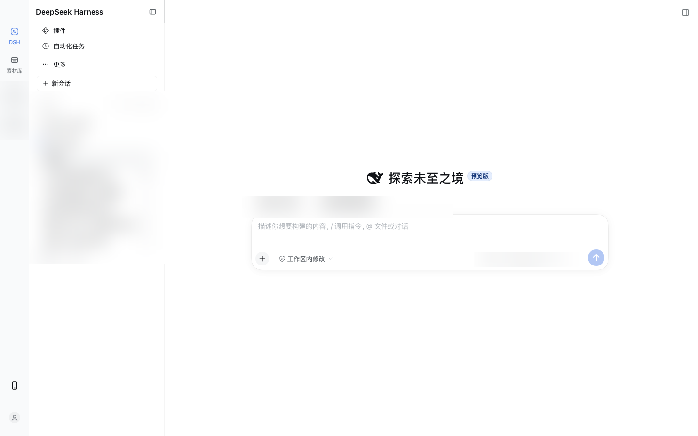

# 三栏应用布局 | Three-Column App Layout

[](LICENSE)  

[English](README.en.md) | 中文

通用的 DSH 布局插件，提供应用图标栏、应用专属第二栏和主内容区。显示名称为「三栏应用布局」（英文 Three-column app layout），包标识为 `@fenixgo/dsh-three-column-layout`，Loader 行为 `layout-shell`。



> 截图中工作区、会话名和业务内容已打码。

## 布局行为

- 第一栏展开、收起时均为 60px；图标按钮之间的纵向间距为 6px，按钮上下留白为 8/7px，图标与文字标签之间为 6px，两种状态保持一致。
- 悬浮/选中统一使用蓝色突出色：只改变图标与文字的 `color`，不添加任何底色；图标通过 `currentColor` 跟随。一级栏、第二栏行、新会话和顶部图标按钮共用 `ACCENT_COLOR` 与 `layout-shell-hover-accent` 标准，后续新增交互项沿用此规则。
- 首次加载及每次展开时，外层 sidebar 设为 340px，第二栏默认得到 280px。展开后仍允许原生拖动调整；再次展开恢复默认。
- 收起第二栏时，保留 60px 应用栏，同时从原生布局框架的可用宽度中扣除缺少的占位；主内容不被应用栏遮盖。展开、收起的应用入口、图标和标签保持一致。
- 收起栏使用 `getBoundingClientRect().width` 测量实际外框宽度，并以 ResizeObserver 跟踪变化；占位扣除原生已保留的轨道宽度，不假定边框之外还需加 1–2px。占位样式随侧栏组件清理，框架继续负责重新计算主内容和右栏宽度。
- 会话、插件、定时任务统一归入 DSH。点击「插件」「自动化任务」等 DSH 内部面板时，第一栏 DSH 仍保持选中态；收起时点击 DSH 会展开第二栏。
- 收起状态下的展开按钮置于第一栏顶部；收起后自动计算并预留应用栏宽度，主内容区自适应不再被遮盖。
- 收起状态不再注册独立的 `shell.overlay` 浮动栏；应用栏由仍挂载的 `sidebar` 组件渲染，因此可以通过原生 `renderSlot` 保留底部账户（小人）入口及其交互。
- 收起占位不移动整个 frame，只给 `.centerCol` 和底栏增加同步的左内边距，避免把原生 sidebar 列整体右移造成并排双栏。
- 第二栏是固定 280px 的整块面板，用 `transform: translateX()` 滑进/滑出；原生列宽动画只负责主内容让位，不再逐像素裁切第二栏文字，避免两栏之间出现被挤压的文字碎片。
- 展开/收起动画统一压短到 160ms：原生列宽、主内容补白、第二栏整块滑动同步；界面在约 220ms 后切换展开态/收起态，不等待 DSH 最长 600ms 的 `data-animating` 标记。折叠期间固定 60px 收起栏保持稳定，展开态图标/顶栏不会提前滑过。
- 收起栏使用与展开态完全相同的 60px  border-box、左右 6px 内边距和 48px 顶部内边距；右侧分隔线改为 inset 阴影，不占布局宽度，四个图标的横向和纵向位置都不跳动。
- 折叠按钮移除悬停快捷键气泡，并在点击时取消待显示提示，避免「⌘B」黑框一闪而过。
- 收起和展开状态下都清除顶部标题因 leading 区域预留导致的左侧偏移，并显式锁定原生对齐关系：标题面包屑与标签行同为 8px 左内边距，使会话标题与「对话」等标签左对齐；只给内容列和底栏补左内边距，不改变窗口右边界。
- 应用专属面板由其他插件通过 `sidebar.app.column` 注册；本插件不内置任何业务功能，也不读写任何业务数据。

## 约束、兼容性与 DSH 升级影响

### 基线

- 当前按 **DSH Desktop 0.2.2-rc.1（macOS）** 验证；Windows 标题栏、无 macOS 红绿灯的路径未逐项验证。
- 本质是 **Client-only bundle**：Host 入口为空，不注册 Host Service、不读写存储、不访问网络。
- 插件安装形式是工作区本地 `link:` 目录，不是发布到 registry 的稳定包。

### 强依赖：DSH 私有契约，升级必须复核

这些不是 DSH 的公开稳定 API，升级 rc/正式版后要逐项验证：

1. **`ui-sidebar` 行仍存在且可禁用**
   - `cordis.patch.yml` 依赖 `- id: ui-sidebar / disabled: true`。
   - 如果行 id 或所属包名改变，禁用不会生效，原生侧栏会与本插件同时出现。

2. **`ctx.layout.panels.setSidebar(px)` 内部动作仍存在**
   - 公开 `ctx.layout` 只保证 `selectPanel` / `toggleSidebar` / 右栏方法；设置左栏宽度使用的是未公开的 `panels.setSidebar`。
   - 缺失时：展开宽度可能停在原生 280px，第二栏 280px 面板会与实际列宽不匹配。

3. **Slot 名称与 owner props**
   - 依赖：`sidebar`、`sidebar.panellist`、`sidebar.panellist.actions`、`sidebar.workspaces`、`sidebar.settings`、`sidebar.footer.action`、`sidebar.app.column`、`sidebar.brand.mark`、`sidebar.brand.name`、`sidebar.toggle.badge`、`shell.leading`。
   - `sidebar` 的 `collapsed`、`width`、`drawer`、`renderSlot` owner props 也必须保持。
   - 任一改名/删除会导致应用列表为空、第二栏没有内容或底部账户入口消失。

4. **Client CSS/DOM 选择器**
   - 使用 `.PIRFFq_centerCol`、`.kiGsTW_header`、`.kiGsTW_titleRow`、`.kiGsTW_titleCluster`、`.kiGsTW_crumb`、`.kiGsTW_tabs`。
   - 使用 `data-sidebar-collapsed`、`data-animating`、`data-shell-bottom` 属性判断折叠、动画和底栏占位。
   - 这些哈希 class 或属性一旦变化：主内容可能被遮挡、标题/标签不再左对齐、展开动画可能提前切换。

5. **`dsh.client.inject` 的包名**
   - 当前注入 `@deepseek-ai/dsh-client-ui-layout`、`@deepseek-ai/dsh-client-ui-sidebar`、`@deepseek-ai/dsh-client-ui-workspace`。
   - 包名/激活顺序变化可能导致插件不激活或 `sidebar` 槽位邻居缺失。

### 弱依赖：失效时通常只降级外观

- 主题 token：主色、背景、边框、文字色使用 `--dsw-alias-*` / `--dsw-specific-*`；token 改名只影响观感，蓝色强调色有 `#4176e6` fallback。
- 动画 token：`--ds-ease-in-out`、`--ds-transition-duration-slow` 缺失时可能退回默认/瞬时动画。
- 原生账户入口依赖 `sidebar.settings` 和账户插件注册的 `settings.launcher`；账户插件未启用时，底部只显示空位。

### 固定参数与行为约束

- 第一栏固定 **60px**；第二栏内容固定 **280px**；展开总轨道默认 **340px**。
- 顶栏高度固定 **48px**；展开/收起动画 **160ms**，界面切换等待约 **220ms**。
- 第二栏是固定宽度面板；用户拖拽原生 sidebar 改变外层宽度时，第二栏内容仍保持 280px，多出的宽度会留白。再次展开会恢复 340px。
- 窄窗口仍受 DSH 原生规则影响：`<1024px` 自动折叠，`<768px` 切换为 drawer；drawer 模式未做完整视觉验收。
- 右侧栏未由本插件实现；如果同时打开右侧栏，主内容居中/补白行为需要一并验证。
- macOS 红绿灯是 Electron 原生窗口控件，本插件不能移动、缩放或裁剪，保持 DSH 原生位置。

### 与其他插件的关系

- **不能与另一个同时替换 `sidebar` 或禁用 `ui-sidebar` 的布局插件共用**；会出现两个侧栏入口或注册竞争。
- `INSIDE_PANEL_IDS = ['plugins', 'schedules']` 是硬编码：名单内面板显示为 DSH 内部行，其他新面板自动成为第一栏应用图标。DSH 新增内部面板时需要更新此名单。
- 其他插件可通过 `sidebar.app.column` 注册自己的应用第二栏；没有注册时本插件显示空态提示卡。
- 本插件不拥有、不读写任何业务数据；业务功能完全由其他插件负责。

### DSH 升级检查清单

1. 启动后打开插件页，确认 `ui-sidebar` 行仍存在、本 bundle 的 `layout-shell` 行处于 **active**。
2. 用 Client Slot 检查树确认上述槽位名称和 owner props 未变。
3. 检查 `ctx.layout.panels.setSidebar` 是否仍可调用；若不可用，改用当时公开的布局 API 或退回固定 280px 并提示。
4. 检查浏览器 DOM 中 `.PIRFFq_centerCol`、`.kiGsTW_*`、`data-animating`、`data-sidebar-collapsed`、`data-shell-bottom` 是否仍存在。
5. 实测：首次展开、收起、再次展开、账户小人、标题/「对话」左对齐、右侧栏、窄窗口 drawer。
6. 若 DSH 新增内部面板，更新 `INSIDE_PANEL_IDS`，否则它会错误地出现在第一栏。
7. 升级前保留旧 profile 备份；升级后若布局错乱，先禁用本 bundle 验证原生 sidebar 是否恢复。

### 已知失败表现

| 变化 | 可能出现的结果 |
|---|---|
| `ui-sidebar` id 改变 | 原生侧栏和本插件同时出现，或插件完全不接管 |
| `setSidebar` 内部方法消失 | 展开宽度仍为 280px，第二栏面板与主内容错位 |
| `sidebar.*` 槽位改名 | 应用列表为空、第二栏空态、账户入口消失 |
| `.kiGsTW_*` / `data-animating` 改名 | 标题不对齐、收起占位错误、动画提前/滞后 |
| 主题 token 改名 | 蓝色/边框/背景观感异常，但通常不崩溃 |
| 与其它 `sidebar` 替代插件共存 | 双栏、重复图标或注册顺序不确定 |

## 安装

要求：已在 **DSH Desktop 0.2.2-rc.1（macOS）** 验证；其它版本可能因私有契约变化而失效。

```bash
git clone https://github.com/Fenixgo/dsh-three-column-layout.git
```

把克隆后的目录作为一个 bundle 安装进你的 DSH profile：

- 通过 Agent / GUI：`plugin_manager` 的 `install_bundle`，`target` 指向该目录；
- 通过 CLI：`dsh plugin --profile <profile> add /path/to/dsh-three-column-layout`。

停用或卸载整个 bundle 即可撤销对侧栏的替换，原生侧栏自动恢复。

## 文件说明

- `client.js`：布局、应用入口和宽度恢复逻辑。
- `index.js`：空 Host 入口。
- `cordis.patch.yml`：替换原生侧栏的补丁。
- `locale/zh.json`、`locale/en.json`：插件管理页显示名称与描述。
- `icon.svg`：插件图标。
- `docs/screenshot.png`：插件说明中的桌面端预览图（业务内容已打码）。
- `CHANGELOG.md`、`CONTRIBUTING.md`：版本历史与贡献说明。

## 开发说明

本地以 `link:` 目录方式安装时，修改 `client.js` 后刷新页面即可加载新的客户端资源（HMR）；改动 manifest（`package.json` / `cordis.patch.yml`）后需要重启或按插件管理器返回的步骤重新加载。

## License

[MIT](LICENSE)
